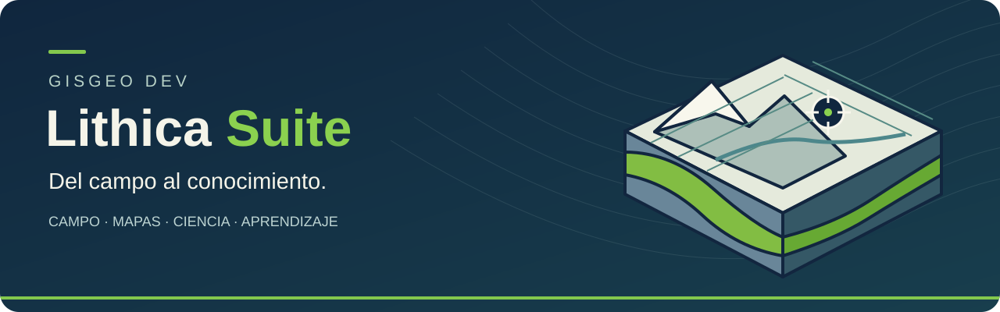
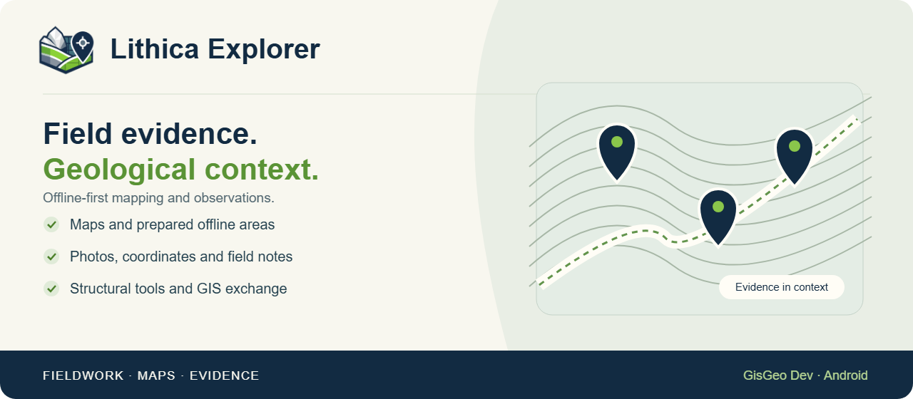
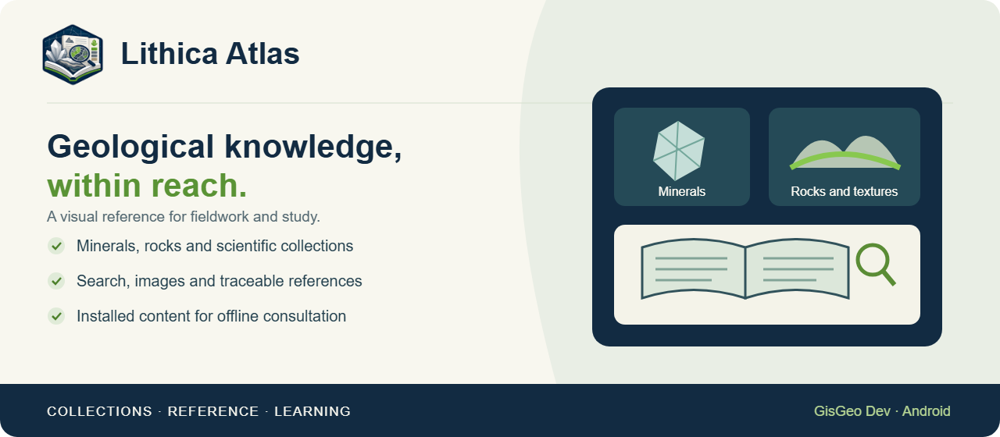
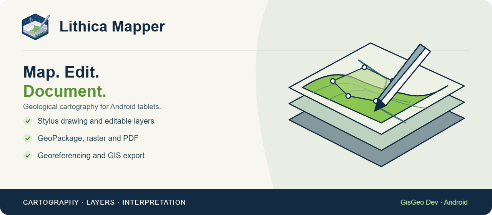

<strong>Español</strong> · <a href="README.md" lang="en">English</a>

  

<strong>Observa · Mapea · Consulta · Interpreta · Aprende</strong>

Herramientas para acompañar el trabajo geológico, desde la evidencia de campo hasta los mapas, la consulta científica y el estudio.

<a href="#encuentra-tu-herramienta">Explorar productos</a> · <a href="RELEASES.md">Descargas y acceso</a> · <a href="https://gisgeo.dev/es/portfolio/lithica-suite/">Sitio web</a> · <a href="https://gisgeo.dev/es/contact/">Contacto</a>

## Una familia de herramientas geocientíficas

Lithica reúne aplicaciones y recursos para geología de campo, cartografía, geotecnia, lectura científica, modelamiento y teledetección. Cada herramienta resuelve una parte del trabajo: registrar evidencia con su contexto, construir mapas, consultar referencias o explorar una interpretación.

El trabajo local y la preparación offline son centrales en las aplicaciones de campo. Las funciones de cuenta, adquisición de datos y sincronización tienen sus propios requisitos de conexión.

<table>
<tr>
<td align="center" width="25%"> <strong>Explorer</strong> Tu cuaderno de campo geológico</td>
<td align="center" width="25%"> <strong>Mapper</strong> Cartografía geológica con lápiz</td>
<td align="center" width="25%"> <strong>Atlas</strong> Referencia geocientífica a mano</td>
<td align="center" width="25%"> <strong>Notebook</strong> Lee, anota, estudia y calcula</td>
</tr>
<tr>
<td align="center" width="25%"> <strong>GeoTech</strong> Consulta y evaluación geotécnica</td>
<td align="center" width="25%"> <strong>Cloud Sync</strong> Del respaldo de campo a QGIS</td>
<td align="center" width="25%"> <strong>GeoModeller</strong> Interpretación geológica en tres dimensiones</td>
<td align="center" width="25%"> <strong>Spectra</strong> De la escena satelital a la interpretación</td>
</tr>
</table>

También forman parte de la familia **[Academy](apps/LITHICA_ACADEMY.md)**, con rutas educativas en español, y **[GeoTech Community](apps/LITHICA_GEOTECH_COMMUNITY.md)**, una edición comunitaria independiente bajo GPL.

## Encuentra tu herramienta

| Quieres… | Herramienta | Qué te aporta |
| --- | --- | --- |
| Registrar una campaña de campo | [Explorer](apps/LITHICA_EXPLORER.md) | Observaciones, coordenadas, fotografías, documentos y mapas preparados. |
| Dibujar y editar cartografía | [Mapper](apps/LITHICA_MAPPER.md) | Lápiz, capas, simbología, georreferenciación y exportación GIS. |
| Consultar referencias geocientíficas | [Atlas](apps/LITHICA_ATLAS.md) | Colecciones, fichas visuales, búsqueda, citas y contenido instalado. |
| Leer, anotar y estudiar | [Notebook](apps/LITHICA_NOTEBOOK.md) | Documentos científicos, tinta PDF, agenda y Python opcional en el dispositivo. |
| Evaluar un macizo rocoso | [GeoTech](apps/LITHICA_GEOTECH.md) | RMR, Q-System, Hoek-Brown y referencias técnicas. |
| Abrir respaldos de campo en QGIS | [Cloud Sync](apps/LITHICA_CLOUD_SYNC.md) | Lectura de proyectos Explorer y Mapper desde Google Drive. |
| Explorar un modelo geológico 3D | [GeoModeller](apps/LITHICA_GEOMODELLER.md) | Interpretación implícita, topografía y visualización tridimensional. |
| Analizar escenas y bandas | [Spectra](apps/LITHICA_SPECTRA.md) | Adquisición y procesamiento espectral local. |
| Seguir prácticas guiadas | [Academy](apps/LITHICA_ACADEMY.md) | Módulos de Leapfrog Geo, Oasis montaj y GravMag. |
| Consultar la edición geotécnica abierta | [GeoTech Community](apps/LITHICA_GEOTECH_COMMUNITY.md) | Código comunitario, con licencia y evolución propias. |

## Explora las aplicaciones

### Lithica Explorer

Registra evidencias y conserva su contexto geológico.

### Lithica Atlas

Explora colecciones visuales y referencias científicas.

### Lithica Mapper

Dibuja, organiza e intercambia cartografía geológica.

## Del campo al escritorio

1. **Prepara** el área, las capas y los documentos que necesitarás sin cobertura.
2. **Registra** observaciones y evidencias en Explorer o **edita** la cartografía en Mapper.
3. **Consulta** referencias en Atlas y herramientas geotécnicas en GeoTech; **anota y estudia** en Notebook.
4. **Exporta** archivos GIS o utiliza los respaldos opcionales de Drive para abrir proyectos en QGIS con Cloud Sync.

Las aplicaciones conservan proyectos propios. Cloud Sync es un puente de lectura hacia QGIS: las ediciones realizadas allí no regresan automáticamente a las apps. Conserva copias independientes de las campañas importantes.

## Descargas y disponibilidad

**Explorer, Mapper y Atlas** están disponibles en Google Play para Android. **GeoTech** tiene acceso mediante prueba cerrada. **Cloud Sync** se distribuye como plugin QGIS. Notebook, GeoModeller y Spectra continúan en desarrollo; Academy es material educativo.

Consulta **[Descargas y acceso](RELEASES.md)** para elegir el canal correcto. El soporte de una plataforma en el proyecto no implica que ya exista un instalador público para ella.

 

## Preguntas frecuentes

**¿Necesito instalar toda la Suite?**

Puedes elegir la herramienta que corresponda a tu tarea. No hay un instalador único para toda la familia.

**¿Puedo trabajar sin conexión?**

Las aplicaciones de campo permiten trabajar con recursos preparados localmente. El primer acceso, la renovación de cuenta, las fuentes online y Drive requieren conexión. Comprueba el acceso y los archivos antes de salir.

**¿Toda la Suite es de código abierto?**

Cada producto tiene sus propias condiciones. Cloud Sync y GeoTech Community cuentan con repositorios públicos y licencias indicadas en sus fichas. La disponibilidad de este catálogo no otorga una licencia común al código, marcas o contenido de las demás aplicaciones.

**¿Dónde encuentro ayuda o envío comentarios?**

Consulta la [web de GisGeo Dev](https://gisgeo.dev/es/portfolio/lithica-suite/) y la [página de contacto](https://gisgeo.dev/es/contact/). Para Cloud Sync y Community también puedes utilizar las incidencias de sus repositorios. Evita publicar datos personales o información confidencial de proyectos.

---

<strong>Lithica Suite · GisGeo Dev</strong> Herramientas geocientíficas para campo, gabinete y aprendizaje.

