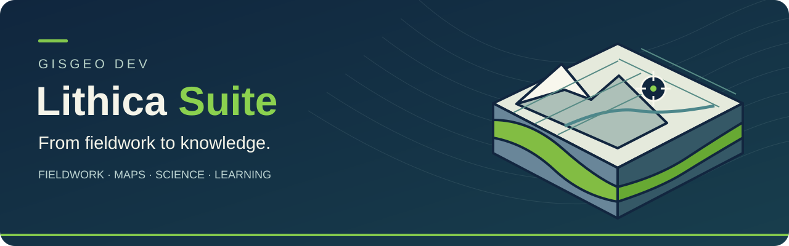
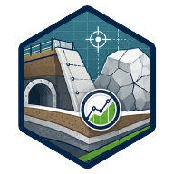
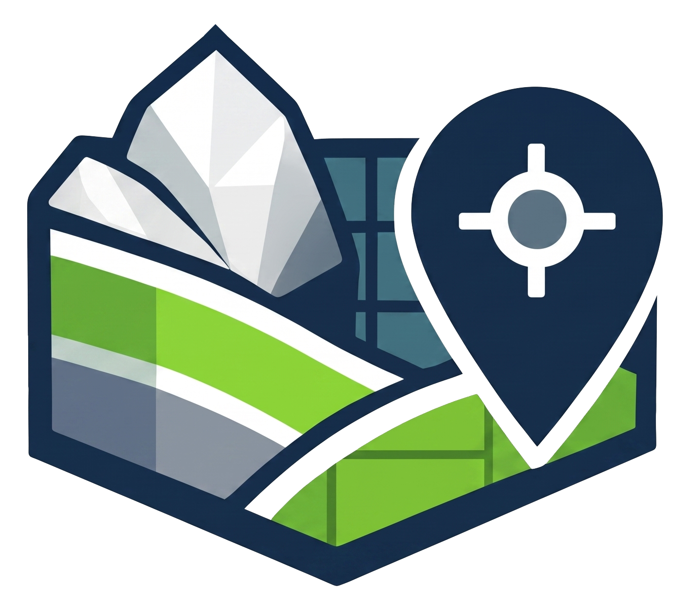
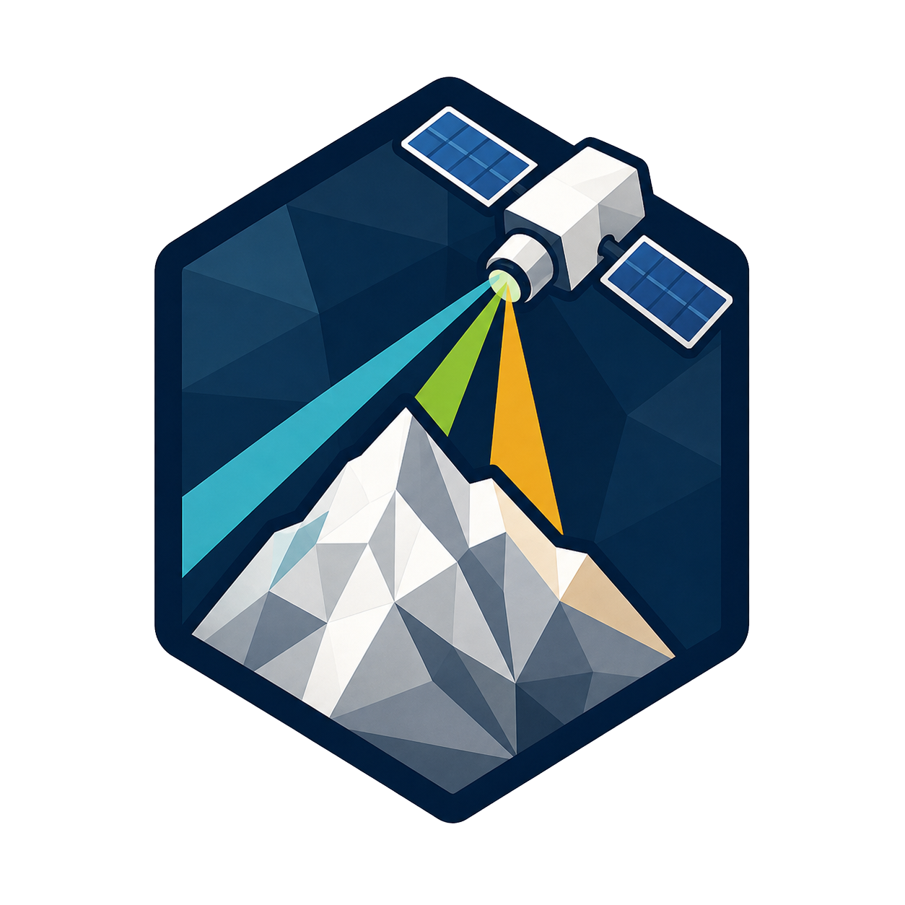

<a href="README.es.md" lang="es">Español</a> · <strong>English</strong>

  

<strong>Observe · Map · Explore · Interpret · Learn</strong>

Tools for geological work, from field evidence to maps, scientific reference and study.

<a href="#find-your-tool">Explore products</a> · <a href="RELEASES.en.md">Downloads and access</a> · <a href="https://gisgeo.dev/portfolio/lithica-suite/">Website</a> · <a href="https://gisgeo.dev/contact/">Contact</a>

## A family of geoscience tools

Lithica brings together applications and resources for field geology, mapping, geotechnics, scientific reading, modeling and remote sensing. Each tool supports part of the workflow: recording evidence in context, building maps, consulting references or exploring an interpretation.

Local work and offline preparation are central to the field applications. Account features, data acquisition and synchronization have their own connectivity requirements.

<table>
<tr>
<td align="center" width="25%"> <strong>Explorer</strong> Your geological field notebook</td>
<td align="center" width="25%"> <strong>Mapper</strong> Geological mapping with a stylus</td>
<td align="center" width="25%"> <strong>Atlas</strong> Geoscience reference at hand</td>
<td align="center" width="25%"> <strong>Notebook</strong> Read, annotate, study and compute</td>
</tr>
<tr>
<td align="center" width="25%"> <strong>GeoTech</strong> Geotechnical reference and assessment</td>
<td align="center" width="25%"> <strong>Cloud Sync</strong> From field backups to QGIS</td>
<td align="center" width="25%"> <strong>GeoModeller</strong> Geological interpretation in three dimensions</td>
<td align="center" width="25%"> <strong>Spectra</strong> From satellite scenes to interpretation</td>
</tr>
</table>

The family also includes **[Academy](apps/en/LITHICA_ACADEMY.md)**, with Spanish-language learning paths, and **[GeoTech Community](apps/en/LITHICA_GEOTECH_COMMUNITY.md)**, an independent community edition under the GPL.

## Find your tool

| You want to… | Tool | What it provides |
| --- | --- | --- |
| Record a field campaign | [Explorer](apps/en/LITHICA_EXPLORER.md) | Observations, coordinates, photographs, documents and prepared maps. |
| Draw and edit geological maps | [Mapper](apps/en/LITHICA_MAPPER.md) | Stylus input, layers, symbology, georeferencing and GIS export. |
| Consult geoscience references | [Atlas](apps/en/LITHICA_ATLAS.md) | Collections, visual records, search, citations and installed content. |
| Read, annotate and study | [Notebook](apps/en/LITHICA_NOTEBOOK.md) | Scientific documents, PDF ink, planning and optional on-device Python. |
| Assess a rock mass | [GeoTech](apps/en/LITHICA_GEOTECH.md) | RMR, Q-System, Hoek-Brown and technical references. |
| Open field backups in QGIS | [Cloud Sync](apps/en/LITHICA_CLOUD_SYNC.md) | Read Explorer and Mapper projects from Google Drive. |
| Explore a 3D geological model | [GeoModeller](apps/en/LITHICA_GEOMODELLER.md) | Implicit interpretation, topography and three-dimensional visualization. |
| Analyze scenes and bands | [Spectra](apps/en/LITHICA_SPECTRA.md) | Acquisition and local spectral processing. |
| Follow guided exercises | [Academy](apps/en/LITHICA_ACADEMY.md) | Leapfrog Geo, Oasis montaj and GravMag modules. |
| Explore the open geotechnical edition | [GeoTech Community](apps/en/LITHICA_GEOTECH_COMMUNITY.md) | Community source code with its own license and development. |

## Mapping in the field and office

Mapper presentation material with Spanish interface examples. Interfaces may vary between versions; check its product page and distribution channel.

## From fieldwork to the desktop

1. **Prepare** the area, layers and documents you will need beyond network coverage.
2. **Record** observations and evidence in Explorer or **edit** geological maps in Mapper.
3. **Consult** Atlas references and GeoTech tools; **annotate and study** in Notebook.
4. **Export** GIS files or use optional Drive backups to open projects in QGIS through Cloud Sync.

Applications keep their own projects. Cloud Sync is a read-only bridge to QGIS: edits made there are not automatically returned to the apps. Keep independent copies of important campaigns.

## Downloads and availability

**Explorer, Mapper and Atlas** are available on Google Play for Android. **GeoTech** offers access through closed testing. **Cloud Sync** is distributed as a QGIS plugin. Notebook, GeoModeller and Spectra remain in development; Academy is educational material.

See **[Downloads and access](RELEASES.en.md)** for the appropriate channel. Platform support in a project does not establish that a public installer is already available.

## Frequently asked questions

**Do I need to install the entire Suite?**

Choose the tool that fits your task. There is no single installer for the whole family.

**Can I work offline?**

The field applications support work with locally prepared resources. First sign-in, account renewal, online sources and Drive need connectivity. Check access and files before leaving coverage.

**Is the entire Suite open source?**

Each product has its own terms. Cloud Sync and GeoTech Community have public repositories and licenses listed on their product pages. This public catalog does not grant a common license over the other applications' code, branding or content.

**Where can I get help or send feedback?**

Visit the [GisGeo Dev website](https://gisgeo.dev/portfolio/lithica-suite/) and [contact page](https://gisgeo.dev/contact/). Cloud Sync and Community also accept issues in their repositories. Avoid posting personal data or confidential project information.

---

<strong>Lithica Suite · GisGeo Dev</strong> Geoscience tools for fieldwork, office work and learning.

