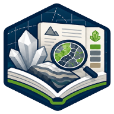

**Español** · [English](en/LITHICA_ATLAS.md)

# Lithica Atlas

**Referencia geocientífica a mano.** Consulta minerales, rocas, texturas, fósiles, estructuras y otras colecciones geocientíficas con fichas visuales y referencias bibliográficas.

## Qué puedes hacer

- Búsqueda y filtros para explorar colecciones y propiedades diagnósticas.
- Imágenes, citas, tablas, glosario y guías de consulta.
- Interfaz en seis idiomas; el contenido utiliza fallback cuando falta una traducción.
- Catálogo instalado por módulos y consulta local durante una sesión verificada.

## Uso y disponibilidad

La preparación inicial requiere conexión, espacio libre y tiempo para descargar el catálogo. El acceso y su renovación requieren verificación online. La disponibilidad de una traducción depende de cada ficha; las referencias apoyan el criterio profesional.

**Estado:** Disponible en Google Play.

[Más información en GisGeo Dev](https://gisgeo.dev/es/portfolio/lithica-atlas/).

[Descargas y acceso](../RELEASES.md) · [Todas las herramientas](../README.es.md).
