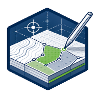
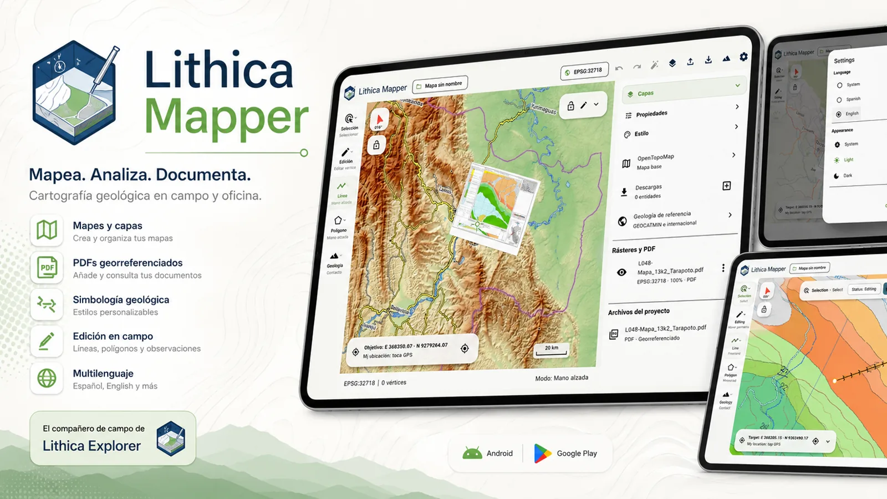

**Español** · [English](en/LITHICA_MAPPER.md)

# Lithica Mapper

**Cartografía geológica con lápiz.** Dibuja unidades, contactos, fallas y estructuras sobre un espacio cartográfico pensado para tablets Android, con edición por lápiz y navegación táctil.

## Qué puedes hacer

- Dibujo libre, por vértices y mixto, con selección, transformación y deshacer.
- Capas editables, estilos, símbolos estructurales y texturas geológicas.
- GeoPackage, importación vectorial, georreferenciación de imágenes y PDF.
- Mapas preparados offline, terreno, columnas estratigráficas y exportación GIS.

## Uso y disponibilidad

Comprueba unidades, datum y SRC al combinar datos. La cuenta se verifica con conexión; el trabajo local preparado puede continuar offline. Drive es opcional y sus copias pueden leerse en QGIS mediante Cloud Sync.

**Estado:** Disponible en Google Play.

[Descargar en Google Play](https://play.google.com/store/apps/details?id=com.gisgeodev.lithicamapper).

Material ilustrativo; la interfaz puede variar según la versión.

[Más información en GisGeo Dev](https://gisgeo.dev/es/portfolio/lithica-mapper/).

[Descargas y acceso](../RELEASES.md) · [Todas las herramientas](../README.es.md).
