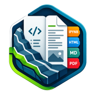

**Español** · [English](en/LITHICA_NOTEBOOK.md)

# Lithica Notebook

**Lee, anota, estudia y calcula.** Reúne lectura de documentos científicos, anotaciones PDF, una biblioteca de trabajo, agenda de estudio y ejecución opcional de notebooks en el propio dispositivo.

## Qué puedes hacer

- IPYNB, PDF, HTML, Markdown, documentos Office, EPUB, tablas e imágenes.
- Anotaciones y copias de trabajo separadas de los originales.
- Agenda, temporizador y recordatorios locales sujetos a los permisos del sistema.
- Lithica Lab: Python local en Android y Windows, con preparación de dependencias.

## Uso y disponibilidad

Abrir un documento no ejecuta su código. Lab ejecuta solo cuando lo solicitas y puede necesitar conexión para instalar paquetes compatibles. No admite cualquier paquete de escritorio ni garantiza una composición idéntica a Word al exportar. Todavía no se ofrece una descarga pública verificada.

**Estado:** En desarrollo.

[Más información en GisGeo Dev](https://gisgeo.dev/es/portfolio/lithica-notebook/).

[Descargas y acceso](../RELEASES.md) · [Todas las herramientas](../README.md).
