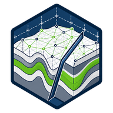

[Español](../LITHICA_GEOMODELLER.md) · **English**

# Lithica GeoModeller

**Geological interpretation in three dimensions.** Develop and review implicit geological models using contacts, orientations, drillhole data and topography, with three-dimensional visualization.

## What you can do

- GeoPackage, geological CSV and drillhole table imports.
- ESRI ASCII topography and input-data review.
- A Flutter visualization client with GemPy computation.
- Structural tools and estimates of volume and tonnage.

## Use and availability

Computation requires an available engine and valid input data. Review coordinate systems, units, intervals and quality before interpolation. Estimated volumes or tonnages do not certify mineral reserves. No verified public installer is available.

**Status:** In development.

[More information on GisGeo Dev](https://gisgeo.dev/portfolio/lithica-geomodeller/).

[Downloads and access](../../RELEASES.en.md) · [All tools](../../README.en.md).
